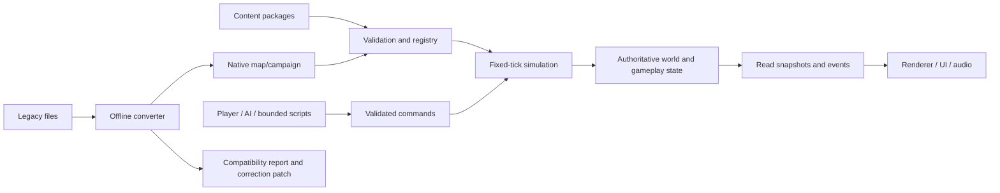

# Architecture overview

Status: Phase 0 design, 2026-11-14. Future modules below are planned boundaries,
not implemented APIs. [Decisions](decisions.md) separates settled direction from
proposals. There is no KeeperFX runtime compatibility layer.

## Current workspace and growth rule

Only `crates/nexus-world` exists: a std-only library for `VoxelPos`, `ChunkPos`,
`LocalPos`, Euclidean splitting and checked reconstruction. It has no ECS, asset,
content, persistence, renderer, or platform dependency. A game executable now
would imply functionality we have deliberately deferred.

The proposed eleven-crate layout separates useful responsibilities but creates
empty crates and cross-crate APIs before their consumers exist. Start with
modules, split them when two real consumers, build isolation, or a clear
dependency boundary justify it. Do not create a generic `nexus-core` dumping
ground. Avoid parallel `world`/`voxel` crates until mesh/storage work requires it.

| Future unit | Responsibilities | May depend on |
| --- | --- | --- |
| nexus-world | coordinates, bounded chunk storage, occupancy, surface state | standard/data utility libraries |
| nexus-content | validated definitions, IDs, registry, package resolution | shared format DTOs, no renderer |
| nexus-formats | native versioned DTOs and validation/migrations | serialization, spatial vocabulary |
| nexus-simulation | fixed ticks, authoritative state, command/event order | world, content |
| gameplay/AI modules initially in simulation | jobs, combat, economy, goals, rulesets | simulation APIs, validated definitions |
| nexus-render | chunk meshes, asset presentation, camera, effects | world snapshots, selected engine |
| apps/nexus-game | startup, input mapping, tick scheduling, UI, integration | simulation, content, render, native loader |
| apps/nexus-editor | native campaign/map editing and validation | native formats, world, content, optional render |
| apps/nexus-converter | legacy parsing, mapping, reports, native output | native formats/content validation; **no game runtime** |
| modding/scripting modules | package policies and bounded script host | content/simulation command API |

Do not build an engine abstraction supporting several renderers simultaneously.
Keep domain data free of engine handles; a concrete Bevy/Fyrox adapter can own
presentation entities and resource lifetimes when selected.

## Runtime data flow (proposal)

Authoritative mutations run through commands checked against current world,
ownership, faction capabilities, resources, and rules. Events describe committed
results; visual effects never decide damage or ownership. Tick rate remains a
profiling/design choice. Specify ordering and seeded RNG before combat/replays;
network determinism and multiplayer are not Phase 0 commitments.

Renderer frame timing is independent of simulation ticks. Mesh generation reads
versioned chunk snapshots on bounded worker queues; discard stale results after
terrain changes. Rendering must not own gameplay occupancy. Pathfinding uses
derived walkability and invalidation from mutations, not mesh triangles.

## Core state responsibilities

- World: 3D material cells and separate sparse ownership, reinforcement, damage,
  floor/room references; no giant native-compatible global struct.
- Entity state: stable native IDs, position, components and definition references;
  ECS handle identity is not a save identifier. Exact ECS integration is open.
- Content: namespaced stable text IDs on disk; validated compact handles at runtime.
  Neither faction count nor creature/room registries use historical fixed caps.
- Rulesets: explicit capabilities and configurable policies; no mandatory gold,
  mana, worker, torture, or shared progression tree for every faction.
- Persistence: maps are authored initial state; saves add dynamic state, tick,
  RNG state and exact content lock. Neither encodes raw Rust/ECS memory.

Resource budgets and validated bounds still exist for safety and performance;
they are explicit diagnostics/configuration, not inherited magic limits.

## Cross-platform and failure boundaries

Desktop Linux/Windows/macOS plus Android on ARM and x86 are intended platform
goals. Keep ARM64 desktop portability visible too. The current library's
cross-target compilation checks do not establish an Android app or device
support; see [platform support](platform-support.md) for ABI coverage and gates.
Browser, iOS and console releases are not planned by this change. Native save
paths, asset casing, UTF-8 IDs, atomic writes and bounded loading need platform
tests. GPU capability/quality tiers must be measured with real chunk edits,
lights and animated creatures, including mobile memory and thermal constraints.

The future application layer translates mouse/keyboard, touch and optional
controller actions into the same simulation commands. Camera gestures, selection,
dig/claim orders and HUD layouts need touch-specific design and readable scaling;
never require pointer hover or a physical keyboard for core play. Mobile lifecycle
handling, safe checkpoint saves and suspend/resume belong at the app boundary.
Keep package loading behind a storage interface that can use app-private storage
and user-selected imports rather than assume arbitrary desktop filesystem paths.
These are architecture requirements, not implemented input/storage systems.

Malformed content yields file/field/ID diagnostics before world startup. Unknown
required features block loading. Optional visual omissions may use explicit
placeholders with warnings; never silently replace gameplay definitions.
Scripts receive narrow capabilities, budgets and deferred commands, without
arbitrary filesystem, network, or native library loading. Script language and
sandbox are unselected. No unsafe code is needed in today's library.
